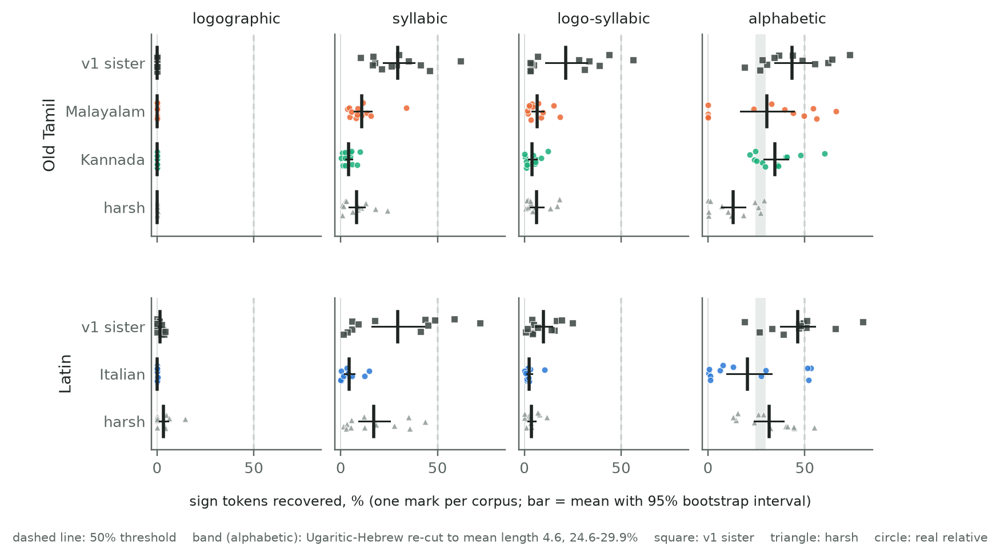
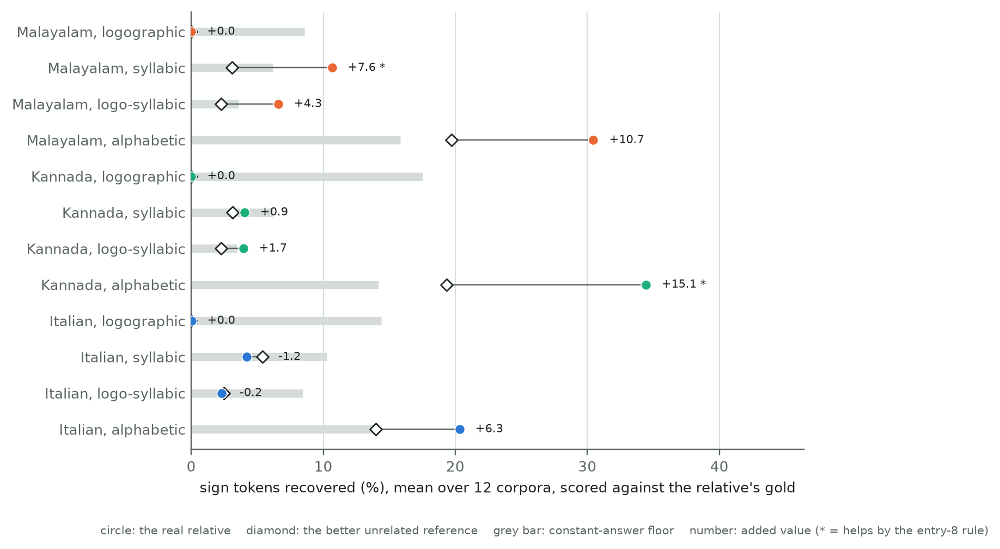
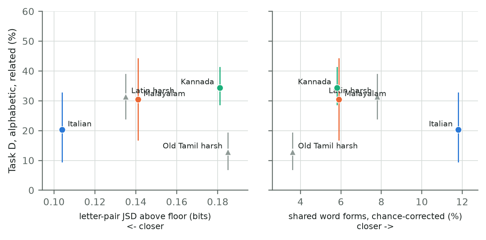

# DRAFT v2 section (for review; not for deposit): real related languages written in different texts

Status: draft written 2026-10-20, revised 2026-10-21 after an audit for oversights, on branch `v2`,
from the reports named in each paragraph. It does not change any v1 number or the v1 paper
(`paper-v1`). Every number here is a v2 result, and every decimal in it is checked against a
generated report (`reports/v2/cd/analysis/check_numbers.py`). Methods are frozen at `frozen-v2`
(commit `4ce3e90`); pre-registration entries 1-8 are in `docs/v2_preregistration.md`. Each claim
is labelled pre-registered, exploratory or post hoc. Nothing here is, or claims, a decipherment.

## Key findings

- **0 of 12** cells (3 real relatives × 4 script types) reach a 50% mean, on either seed block.
  Pre-registered (entry 6) and replicated on fresh seeds (entry 7).
- **2 of 12** cells show the relative beating an unrelated language by the rule fixed before that
  control ran: Kannada, alphabetic (+15.1 points) and Malayalam, syllabic (+7.6). Italian never does.
  Entry 8, C1.
- **14.0-19.7%** of alphabetic tokens are recovered with an unrelated Finnish reference, scored against
  the relatives' own gold, and a constant answer gets 14.2-15.8%. An unrelated reference thus reaches
  more than half of the 20.3-34.4% that a real relative reaches (the shares, not necessarily the same
  tokens). Entry 8, C1 and C2.
- **+11.5 points** for Old Tamil-Malayalam, alphabetic, with 10 EM restarts instead of 3 (30.4% to
  41.9%): the only first-order budget effect. All 120 reruns at 3 restarts reproduce the frozen
  records exactly. Entry 8, C3 and C4.
- **Bracket failed** for Latin: Italian scores below the synthetic `harsh` setting on both seed blocks,
  although it is closer to Latin on every yardstick, and more restarts widen the gap (`harsh` 43.6%,
  Italian 18.1%). Post hoc, negative result 3.
- **0.0%** logographic recovery with every real relative, below a constant answer (8.6-17.5%). The
  solver can only output the reference's 250 most frequent words, and the hidden language's frequent
  words have rare cognates: Latin *et* is rank 2,592 in Dante. Exploratory.

## Epistemic status of the main claims

| Claim | Evidence | Status | Robustness | What would change it |
|---|---|---|---|---|
| No real relative brings a script type to a 50% mean | Tables v2.3, v2.5; R1 | Pre-registered (entries 6, 7) | Replicated; holds at 10 restarts (highest 41.9%) | A stronger solver; other relatives or texts |
| A relative helps measurably in only 2 of 12 cells | C1 | Procedure pre-registered (entry 8), motivation post hoc | One run of 12 corpora per cell; the rule's thresholds are a choice | Other unrelated references; other gold tables |
| Old Tamil alphabetic recovery is in the range of the Ugaritic anchor | R2; Ugaritic report | Pre-registered check | Replicated | Nothing here: it is a consistency check, not confirmation |
| Italian falls below `harsh` (the bracket fails) | Tables v2.3, v2.5; R3; C3 | Observation post hoc; R3 pre-registered | Replicated; widens with more restarts | A genre-matched Italian text; other Romance texts |
| Closeness on the yardsticks does not predict Task D | Figure v2.3; frequency check | Exploratory | Five points | More pairs |
| Logographic zeros are partly a solver artefact | Reachability check | Exploratory | Computed exactly, no solver | A solver without a unit cap |
| Solver budget is second-order except for one cell | C3 | Pre-registered | Seeds 0-2 only | More restarts or another optimiser |
| The runs are deterministic | C4 | Pre-registered | 120 of 120 identical | - |

## v2.1 Why real relatives

The v1 `related` tier used a synthetic sister cut from the other half of the hidden language's own
source text. It shares phrases with the hidden text and keeps its vocabulary, morphology and word
order, so it is far closer than any attested relative of an undeciphered script is likely to be
(v1, Section 3.6, Table 2). Stage 2 first tried to make the synthetic sister realistic by
calibrating it to the distance between Ugaritic and Hebrew, the classic real case for computational
decipherment (Snyder, Barzilay & Knight 2010). That failed for all five languages in
both settings tried: every mechanism that changes letter pairs also destroys shared word forms, and
a sister cut from the same text keeps too much verbatim text (`docs/v2_negative_results.md`, item 2).
Stage 2 therefore measures real related languages written in different texts, with no tuning and no
targets: whatever distance each real pair has is the distance used (pre-registration entry 5).

## v2.2 Pairs, texts and gold correspondences

*Table v2.1. Real relatives. Each pair is labelled by relationship in every table.*

| Hidden (v1 source) | Relative | Relationship | Relative's text | Gold correspondences (cited per row) | Status |
|---|---|---|---|---|---|
| Latin (Caesar, Vergil) | Italian | descendant, of spoken (Vulgar) Latin rather than the Classical written language (Grandgent 1907: §§3-4) | Dante, *La Divina Commedia*, Project Gutenberg #1000 (public domain in the USA) | Grandgent (1907), section per row | measured |
| Old Tamil (Sangam anthologies) | Malayalam | descendant: "a very ancient offshoot of Tamil… not a sister of Tamil, but a daughter" (Caldwell 1875: 23-24; Gundert, reported there, disagreed) | Ezhuthachan, *Adhyātma Rāmāyaṇam Kiḷippāṭṭu*, Malayalam Wikisource (CC BY-SA 4.0) | Caldwell (1875), pages per row | measured |
| Old Tamil | Kannada | sister: one of Tamil's "sister idioms" (Caldwell 1875: vi), a separate cultivated language (33-34) | Kumāravyāsa, *Karṇāṭa Bhārata Kathāmañjari*, Kannada Wikisource (CC BY-SA 4.0) | Caldwell (1875), pages per row | measured |
| Finnish (Kalevala) | Estonian | sister | Kreutzwald, *Kalevipoeg*, Estonian Wikisource, cantos I-XX | Pajusalu (2012), not yet read | text parsed; gold pending |
| Sanskrit (Rāmāyaṇa) | Pali | descendant | - | - | blocked: no text with clear terms |
| Sumerian | - | isolate | - | - | `none` tier only |

**Data notes.**

- The two Wikisource transcriptions state no source edition. They were accepted as clean by the
  project owner (2026-10-15): they carry the CC BY-SA site licence and do not link to the
  CC BY-NC-ND scan on Internet Archive.
- Kannada coverage is partial: 93 of the 154 sandhi pages linked from the ten parva pages exist,
  mostly Ādi, Virāṭa and Karṇa parvas. The two commentary (ಸಟೀಕಾ) pages are excluded. Each sandhi page
  opens with a short invocation that may be in Sanskrit; it was not removed.
- Revision ids and SHA-256 hashes per page are kept with the raw data.

**Registers, periods and sizes differ across pairs, and none of this is controlled.**

- *Register.* Both hidden languages are literary registers (Classical Latin prose and verse; Sangam
  poetry), while each relative descends from, or is related to, a spoken form. Italian continues
  Vulgar, not Classical, Latin (Grandgent 1907: §§3-4).
- *Period.* The relatives are written many centuries after the hidden texts: Dante (14th century)
  after Caesar and Vergil; Ezhuthachan (16th century) and Kumāravyāsa (15th century) after the Sangam
  anthologies. Kumāravyāsa's Kannada shows the change of initial *p* to *h* that Caldwell calls
  "comparatively recent" (1875: 53): in our text *hattu* 'ten' occurs 28 times and *pattu* once. The
  gold keeps *p* as the regular reflex and *h* as attested, so strict scoring is conservative for
  Kannada.
- *Loans.* Caldwell (1875: 23) notes that Sanskrit loans are fewest in Tamil and most numerous in
  Malayalam; our Old Tamil texts are Sangam poetry, with few.
- *Reference size.* Italian has 391,950 units, Malayalam 479,851 and Kannada 857,617. The v1 Latin and
  Tamil references, cut from the same half of the source as their synthetic sisters, have 118,647 and
  502,785 alphabetic units (`reports/v2/ugaritic/results.md`). Reference size may affect the solver;
  it is not controlled.

**Units and spelling.** Units are those of the v1 hidden language: Latin letters by the v1 greedy
segmentation, and Old Tamil phonemes. Malayalam and Kannada script are converted to the same
phonemes by deterministic tables, tested on hand-checked words. Every pair is measured as written
and normalised, and the normalised value is primary, so that spelling conventions do not count as
language distance (the Hebrew lesson of v2 entry 3):

- Italian: accents stripped, j folded to i, silent h dropped, apostrophes split words.
- Malayalam and Kannada: the voicing and aspiration that Tamil script cannot write are collapsed
  (kh, g, gh → k, and so on).

**Gold tables.** Each hidden unit has a regular reflex (its outcome where no conditioned change
applies) and a list of attested reflexes, with the section or page of the source for every row.
Rows the source does not cover are marked "no source" and are unrecoverable under strict scoring
(Old Tamil h, s, ḵ, ṣ for both Dravidian relatives). Both sources are over a century old; their
basic consonant correspondences are standard, but details are dated. No gold value comes from
Wikipedia. On 2026-10-21 four rows were spot-checked against the scanned texts, and each citation
holds: Kannada initial *p* > *h* (Caldwell 1875: 53), *talei* = Malayalam *tala* (p. 19), Malayalam as
an offshoot of Tamil (pp. 23-24) and Latin *x* > *s* (Grandgent 1907: §255). This is a spot check, not
a full audit.

## v2.3 How far the real relatives are

The Ugaritic-Hebrew yardsticks (v2 anchor) are computed with the same code on each pair. Sample
sizes are matched to the anchor, and chance is estimated from shuffled correspondence maps.

**Cross-script comparisons are indicative only.** Shared word forms and word pairs are not directly
comparable between a consonant-only script (Ugaritic-Hebrew) and scripts that write vowels (all the
other rows): a consonant skeleton matches far more easily than a full word, even after the chance
correction. Comparisons within one script type are the meaningful ones.

*Table v2.2. Yardsticks, normalised spelling (primary). cc = chance-corrected. Real-pair intervals:
bootstrap over the relative's lines, 200 replicates, 95%.*

| Pair | Relationship | Script type | JSD above floor (bits) | Shared word forms, cc | Word pairs, cc | Verbatim 6+ units |
|---|---|---|---|---|---|---|
| Ugaritic-Hebrew (vowel letters removed) | sister | consonant-only | 0.089 | 58.4% | 4.6% | 0.8% |
| Latin-Italian | descendant | alphabet | 0.104 (0.101-0.108) | 11.8% (9.6-11.5%) | 0.6% (0.1-0.7%) | 1.9% (0.7-3.3%) |
| Old Tamil-Malayalam | descendant | abugida | 0.139 (0.137-0.145) | 5.7% (4.0-5.2%) | 0.0% (0.0-0.0%) | 1.8% (0.4-2.4%) |
| Old Tamil-Kannada | sister | abugida | 0.180 (0.178-0.186) | 4.7% (3.8-5.1%) | 0.0% (0.0-0.1%) | 1.0% (0.4-2.4%) |
| Latin, v1-like sister* / `harsh` | synthetic | as hidden | 0.006 / 0.135 | 53.1% / 7.8% | 7.1% / 1.1% | 12.4% / 2.4% |
| Old Tamil, v1-like sister* / `harsh` | synthetic | as hidden | 0.002 / 0.185 | 57.6% / 3.6% | 8.5% / 0.1% | 17.8% / 1.8% |

\* The yardstick stand-in for the v1 sister: sister-v4 with v1-like settings (`reports/v2/sister/`), not
the v1 sister object used in the Task D tables.

For Latin-Italian and Malayalam the plug-in estimate of shared word forms lies above its own
bootstrap interval, because resampling duplicates lines and so lowers the share of distinct forms;
the interval is the conservative reading.

**Reading.**

- On these yardsticks the real relatives sit near the `harsh` setting and far from the v1-like
  sister, which shares 4-12 times as many word forms.
- Malayalam is closer to Old Tamil than Kannada on the letter-pair distance, and the intervals do not
  overlap. That fits the relationship labels, but the two texts also differ in genre, period and size,
  so the distance cannot be attributed to the relationship alone.
- Normalisation matters most where scripts differ most. Kannada writes voicing; collapsing it moves
  the letter-pair distance from 0.309 to 0.180 bits.

**What the verbatim matches are** (exploratory inspection, `reports/v2/real_relatives/verbatim.md`).
Verbatim runs of 6+ units occur in 1.4% (Malayalam), 1.6% (Kannada) and 2.5% (Italian) of sampled
windows, against 0.0-0.1% through shuffled maps and 0.3-0.4% for an unrelated language with a similar
open syllable shape (the v1 Finnish hidden half, letters as they are). They are therefore signal,
but not shared text:

- 60-73% of them run across a word boundary;
- they are mostly short shared morphs and phoneme strings (for example Malayalam *-kkoṇṭu*,
  *colliyatu*, *paricil*), and for Italian, cognate stems and Dante's Latinisms (*principi-*,
  *cantando*, *crudel-*);
- no match is a phrase that respects word boundaries on both sides, so they are not shared formulae.

In Malayalam about a quarter of the matches (35 of 143) exist only after normalisation. By
inspection, most of these pair a native Tamil string with a Sanskrit loanword: the loan is a
coincidental partner, not a shared loan.

## v2.4 Tasks C and D with real relatives

**Design** (entries 1, 2, 4-6).

- **Corpora:** the v1 Indus-point corpora (2,906 texts, mean length 4.6 signs), seeds 0-2, samplers
  A and B, four script types, with the corrected (content-split) sister: 6 corpora per hidden
  language and script type. They were regenerated from the same seeds; all 120 have corpus statistics
  identical to the v1 records (checked 2026-10-20).
- **References:** the relative's whole text at the script's unit level, as v1 writes its
  references:
    - phonemes for alphabetic scripts;
    - CV syllables for syllabic scripts;
    - word forms for logographic scripts;
    - for logo-syllabic scripts, word forms for the relative's 250 most frequent words and syllables
    otherwise.

    No reference carries a correspondence table, so every score is before the cognate step.

- **Tiers:** `related` gives the relative alone. `candidates` gives the relative plus the other v1
  languages.
- **Methods:** the frozen EM solver after Knight et al. (2006), with the revised selection rule
  (primary) and the original rule, and the frequency-rank baseline. Each EM fit keeps the best of 3
  restarts: a frequency-informed start (sign rank *k* to unit rank *k*) and two random starts.
- **Scoring:**
    - Strict (primary): a sign token is right when its predicted unit is the regular reflex of the
    token's hidden value. A logogram is right only when its reflex is a word that occurs in the
    relative (a cognate). Many-to-one predictions are accepted.
    - Lenient (secondary): any combination of attested reflexes counts.
    - Every token counts. The share of tokens that have a strict reflex at all is reported as a
    ceiling.
- **Bracket rows:** beside the real relatives stand the v1 sister (labelled upper bound in entry 4;
  read from the v1 records and scored with the v1 scorer before the cognate step) and `harsh`
  (labelled lower bound in entry 4, which it is not for real relatives: negative result 3).

*Table v2.3. Task D, `related` tier, revised EM, strict score: mean % of sign tokens over 6 corpora
(number of corpora at or above 50%). From `reports/v2/cd/results.md`.*

| Hidden | Relative | Relationship | Logographic | Syllabic | Logo-syllabic | Alphabetic |
|---|---|---|---|---|---|---|
| Old Tamil | v1 sister (upper bound) | synthetic | 0.0 (0) | 26.7 (0) | 19.0 (0) | 42.5 (2) |
| Old Tamil | **Malayalam** | descendant | 0.0 (0) | 6.2 (0) | 5.9 (0) | **30.4 (1)** |
| Old Tamil | **Kannada** | sister | 0.0 (0) | 3.3 (0) | 2.9 (0) | **32.2 (0)** |
| Old Tamil | `harsh` (lower bound) | synthetic | 0.1 (0) | 6.2 (0) | 5.9 (0) | 16.4 (0) |
| Latin | v1 sister (upper bound) | synthetic | 1.4 (0) | 32.2 (1) | 9.8 (0) | 45.4 (2) |
| Latin | **Italian** | descendant | 0.0 (0) | 6.0 (0) | 1.5 (0) | **16.9 (1)** |
| Latin | `harsh` (lower bound) | synthetic | 1.5 (0) | 24.4 (0) | 4.6 (0) | 36.1 (1) |

The real Ugaritic anchor, for comparison (`reports/v2/ugaritic/results.md`; pre-registered 50%
criterion failed): 32.0% (revised EM) and 33.9% (original EM) on natural texts, `related` tier,
alphabetic. The like-for-like condition, texts re-cut to the Indus mean length of 4.6, gives
24.6-29.9% with revised EM.

*Table v2.4. Task C, `candidates` tier: share of corpora (24 per row, all script types) where the
solver picked the right family, and the references the revised rule chose.*

| Hidden | Relative offered | EM revised | EM original | Frequency rank | Chosen by EM revised |
|---|---|---|---|---|---|
| Old Tamil | Malayalam | 0% | 0% | 38% | Latin 16, Finnish 8 |
| Old Tamil | Kannada | 38% | 0% | 8% | Latin 10, Kannada 9, Finnish 5 |
| Latin | Italian | 25% | 0% | 50% | Finnish 18, Italian 6 |
| Old Tamil | v1 sister | 33% | 13% | 13% | Latin 13, sister 8, Finnish 3 |
| Latin | v1 sister | 96% | 8% | 63% | sister 23, Finnish 1 |

For Latin, picking Sanskrit also counts as the right family (Indo-European), as in v1.

**Fresh-seed replication (entry 7, pre-registered).** The whole run was repeated on seeds 3-5 (120
corpora, no errors; the corpora were checked identical to the v1 records before any score was read).
All four checks fixed before the run replicated (`reports/v2/cd/replication.md`):

- R1: every real-relative mean stays below 50% (highest: Kannada, alphabetic, 36.7%).
- R2: Old Tamil alphabetic stays within 10 points of Ugaritic: Malayalam 30.5%, Kannada 36.7%.
- R3: Italian stays below `harsh` for alphabetic (23.8% against 26.8%) and syllabic scripts (2.4%
  against 9.4%). The alphabetic margin is small.
- R4: the revised rule picks the real relative in 0 (Malayalam), 10 (Kannada) and 6 (Italian) of 24
  corpora.

Some cells move a lot between the two seed blocks (Malayalam syllabic 6.2% then 15.1%; Old Tamil
`harsh` alphabetic 16.4% then 9.5%). The pooled means over all 12 corpora are therefore the steadier
summary, and they are given here beside the primary seeds 0-2 tables.

*Table v2.5. Task D, `related` tier, revised EM, strict: mean over 12 corpora (seeds 0-5) with a 95%
bootstrap interval over corpora (descriptive; `reports/v2/cd/pooled.md`).*

| Hidden | Relative | Relationship | Syllabic | Logo-syllabic | Alphabetic |
|---|---|---|---|---|---|
| Old Tamil | v1 sister | synthetic | 29.3 (21.9-38.1) | 21.3 (11.1-32.3) | 43.5 (34.4-53.4) |
| Old Tamil | Malayalam | descendant | 10.7 (6.9-15.7) | 6.6 (3.9-9.7) | 30.5 (16.9-44.2) |
| Old Tamil | Kannada | sister | 4.0 (2.5-5.8) | 3.9 (2.0-6.2) | 34.4 (28.8-41.2) |
| Old Tamil | `harsh` | synthetic | 8.1 (4.3-12.4) | 6.3 (3.0-9.8) | 12.9 (7.0-19.2) |
| Latin | v1 sister | synthetic | 29.3 (16.2-43.1) | 9.7 (5.8-14.4) | 46.3 (37.6-55.3) |
| Latin | Italian | descendant | 4.2 (1.8-6.9) | 2.3 (1.2-3.9) | 20.3 (9.6-32.6) |
| Latin | `harsh` | synthetic | 16.9 (9.3-25.4) | 3.6 (1.8-5.6) | 31.5 (24.0-38.9) |

Logographic scripts are left out of this table: every real relative scores 0.0 there (the full table is
in `pooled.md`).

*Figure v2.1. Task D per corpus, `related` tier, revised EM, strict, seeds 0-5 (12 corpora per row).
Bar: mean with 95% bootstrap interval. Band (alphabetic): the Ugaritic anchor re-cut to mean length
4.6. Scores are often near 0% or near 50% for the same relative and script type.*

## v2.5 Controls: is the relative doing the work?

Pre-registration entry 8 fixed four controls and their readings before they ran (post hoc in
motivation). Results in `reports/v2/cd/controls.md`.

**C1. Unrelated reference.** The same corpora are run with an unrelated v1 language as the only
reference, and its predictions are scored against the real relative's gold, exactly as the
relative's own run. A relative *helps* in a cell only if it adds at least 5 points over the better
unrelated reference and is ahead in at least 9 of the 12 paired corpora.

- It helps in 2 of 12 cells: Kannada, alphabetic (34.4% against Finnish 19.4%; +15.1; 9 of 12) and
  Malayalam, syllabic (10.7% against Latin 3.1%; +7.6; 10 of 12).
- Malayalam alphabetic adds 10.7 points but is ahead in only 7 of 12 corpora, because several of its
  runs fail outright.
- Italian helps nowhere: +6.3 on alphabetic (6 of 12), and below Finnish on syllabic (-1.2) and
  logo-syllabic scripts (-0.2).
- Finnish, which is unrelated to both hidden languages, recovers 14.0-19.7% of alphabetic tokens
  against the relatives' gold. Its transcription shares many letters with ours (*a, i, u, k, t, p, n*),
  so coincidence alone reaches that level.

**C2. Constant-answer floor.** Mapping every sign to the single most common regular reflex scores
14.2-15.8% on alphabetic scripts. The real relatives stay above it there. On logographic scripts
the floor is 8.6-17.5% and every real relative scores 0.0%; on syllabic and logo-syllabic scripts,
Kannada and Italian are at or below it.

**C3. Solver budget.** With 10 EM restarts instead of 3 (the first three identical), only Old
Tamil-Malayalam, alphabetic, moves by more than 10 points: 30.4% to 41.9%. Kannada alphabetic falls
from 32.2% to 28.9%, Italian alphabetic rises from 16.9% to 18.1%, and Latin `harsh` alphabetic rises
from 36.1% to 43.6%. A higher likelihood does not always mean more signs right.

**C4. Determinism.** The 3-restart reruns reproduce all 120 frozen-run values exactly.

**Degeneracy.** The share of sign tokens assigned to the single most common predicted unit is 12.4%
(Old Tamil) and 12.2% (Latin) with the real relatives, against 11.1% and 11.2% with unrelated
references: the solutions do not collapse onto one unit.

**Reachability (exploratory, `reports/v2/cd/reach_check.md`).** The entry-2 ceiling counts a token as
recoverable if its reflex occurs anywhere in the relative, but the frozen solver only predicts among
the reference's 250 most frequent units. On logographic scripts the reachable share is far lower
than the ceiling: 25.4% against 51.4% (Italian), 2.3% against 24.3% (Kannada) and 10.1% against 16.9%
(Malayalam). On syllabic and alphabetic scripts the cap hardly binds. The v1 sister, cut from the
same text as the hidden corpus, shares its frequent words, so the cap rarely binds for it. Logographic
comparisons between the synthetic sister and real relatives are therefore partly a solver artefact.

*Figure v2.2. Each real relative (circle) against the better unrelated reference (diamond) and the
constant-answer floor (grey bar), mean over 12 corpora, scored against the relative's gold. Number:
added value; \* = helps by the entry-8 rule.*

## v2.6 What the results show

1. **No real relative brings any script type to a 50% mean** (pre-registered, replicated).
    - In the `related` tier, 7 of the 144 real-relative runs reach 50% (3 relatives, 4 script types,
      12 corpora each): 2 on seeds 0-2 and 5 on seeds 3-5, all alphabetic. Single runs reach 66.0%
      (Malayalam), while every cell mean stays at or below 36.7% (`reports/v2/cd/pooled.md`).
    - With 10 restarts the highest cell mean on seeds 0-2 is 41.9% (Malayalam, alphabetic).
    - Syllabic and logo-syllabic scripts reach 2.3-10.7% with a real relative over 12 corpora;
      logographic scripts reach 0.0%.
2. **Most of the alphabetic recovery does not need the relative.** An unrelated Finnish reference
   recovers 14.0-19.7% against the relatives' gold, and a constant answer 14.2-15.8%. The relatives
   add 6.3-15.1 points over the better unrelated reference on alphabetic scripts, and by the
   pre-registered rule help measurably in 2 of 12 cells. Italian helps in none.
3. **The Old Tamil alphabetic scores are in the range of the Ugaritic anchor** (30.5% and 34.4%
   against 24.6-29.9% like-for-like), as pre-registered check R2 required. This is a consistency
   check, not corroboration: the conditions differ (section v2.7).
4. **The bracket does not hold** (post hoc; `docs/v2_negative_results.md`, item 3).
    - Italian falls below `harsh` on both seed blocks for alphabetic and syllabic scripts (pooled
      alphabetic 20.3% against 31.5%), and more restarts widen the gap.
    - Kannada falls below `harsh` for syllabic and logo-syllabic scripts on both seed blocks.
    - The real relatives therefore replace the bracket as the primary evidence for this tier. That
      reporting decision was taken after seeing the results.
5. **Closeness on the yardsticks did not predict Task D** (exploratory; Figure v2.3). Italian is
   closer to Latin than `harsh` on every yardstick and agrees better in letter frequencies (unigram
   JSD 0.026 against 0.059; `reports/v2/cd/frequency_check.md`), yet scores lower. A text effect of the
   needed size is documented in the Ugaritic anchor, where a genre-matched Hebrew reference added 5-16
   points.
6. **Logographic zeros are partly a solver artefact** (exploratory; section v2.5). The solver's
   250-unit cap excludes most cognates of the hidden language's frequent words.
7. **Task C rarely finds the real relative** (pre-registered check R4, replicated). The revised rule
   picks it in 0 (Malayalam), 9 and 10 (Kannada) and 6 and 6 (Italian) of 24 corpora on the two seed
   blocks, mostly preferring Latin or Finnish; the original rule picks Sumerian in all 72 corpora of
   seeds 0-2.
8. **Single runs are unstable, and budget matters for one cell.** Scores for the same relative and
   script type range from 0.0% to 66.0% between the 12 corpora (Malayalam, alphabetic), and 10
   restarts raise Malayalam alphabetic by 11.5 points.

*Figure v2.3. Alphabetic Task D (`related` tier, mean and 95% interval over 12 corpora) against two
yardsticks for the same pairs (`harsh` yardsticks measured on seeds 0-2). Same-script pairs only.
Exploratory: five points.*

For Indus, where no relative is agreed and the `candidates` and `none` tiers are the relevant ones,
these results add one point. With these comparison-based solvers, a genuine relative adds little
beyond what an unrelated language or a constant answer already gives, outside alphabetic scripts.
Inside them the added value is modest and unstable.

## v2.7 What these results do not show

- **How hard Indus is.** The hidden corpora are synthetic, generated at Indus scale from known
  languages; the solver is told the script type; and the relative is handed to it. Indus has no agreed
  relative, so the `candidates` and `none` tiers are the relevant ones there.
- **That a real relative is of little use to a human decipherer.** These solvers use neither cognates
  nor sound laws unless given the correspondence table, which is withheld: every score is before the
  cognate step. A human decipherer can use both; these scores say nothing about that.
- **That the relationship, rather than the text, drives the scores.** Each relative is one text of one
  genre and period. In the Ugaritic anchor, a pre-registered tier with a genre-matched Hebrew
  reference (the poetic books) raised revised-EM recovery from 32.0% to 37.2% on natural texts, and
  from 24.6-29.9% to 38.4-43.0% on texts re-cut to mean length 4.6 (`reports/v2/ugaritic/results.md`).
  Text effects of that size could account for the bracket failure.
- **A ranking of sister against descendant.** There are two relatives of one hidden language, with
  different texts, periods and reference sizes.
- **Independent confirmation from Ugaritic.** The Old Tamil alphabetic scores and the like-for-like
  Ugaritic range are similar, but the conditions differ. Ugaritic has 6,928 sign tokens in 29 real
  letters with no synthetic allographs; our corpora have 12,904-13,401 tokens with allographs,
  homophony and polyvalence (`reports/v2/cd/pooled.md`). Hebrew letters also cannot match an unrelated
  reference by coincidence, while Latin-alphabet transcriptions can (control C1). The agreement is a
  consistency check, not corroboration.
- **Statistical significance.** No hypothesis test was pre-registered for these comparisons, and none
  is reported. Intervals are descriptive.

## v2.8 Limitations of this section

1. **Two hidden languages only.** Latin and Old Tamil; Old Tamil has both relatives, so the two
   Dravidian rows share their hidden side and their gold source. Finnish-Estonian is waiting for its
   gold source and will run on the same frozen code. Sanskrit has no relative with clear terms.
2. **Relationship and text are confounded.** Each relative is one text of one genre and period;
   the effect of the relationship cannot be separated from that of the text.
3. **Old gold sources.** Caldwell (1875) and Grandgent (1907) are cited per row, gaps are marked
   rather than filled, and some details are dated.
4. **Unverified transcriptions.** The Wikisource transcriptions state no source edition, and
   Kannada coverage is partial.
5. **Normalisation choices.** Normalisation is fixed in code and tested, but it is a choice, and it
   moves the Kannada distance a great deal.
6. **Scoring choices.**
      - Task D is scored whatever reference the solver chose, as in v1, so a wrong reference can still
     score by coincidence.
      - The logogram cognate rule (the reflex must occur in the relative) makes logographic ceilings
     low by construction.
7. **v1 assumptions still apply.** The solver is told the script type (an oracle). The Ugaritic
   gold table is still secondary: Wikipedia, citing Kogan (2011), which we have not read.
8. **Few corpora per cell, with high variance.** Six corpora per cell in the primary tables, twelve
   when pooled with the replication. Single-corpus scores are often bimodal (near 0% or near 50%),
   and percentile bootstrap intervals over so few corpora understate uncertainty. All intervals here
   are descriptive.
9. **A convenience sample of pairs.** The pairs were chosen for open texts and licences, not as a
   representative sample of real relationships. Nothing here generalises to "real relatives" at
   large.
10. **One solver family.** All solvers are frequency- or EM-based (after Knight et al. 2006), with a
    fixed budget. Neural models and human decipherers, who use cognates and sound laws, may do
    better.
11. **Analysis code outside the freeze guard.** The replication and control drivers and the analysis
    scripts live in `reports/v2/cd/analysis/`, which the frozen-code check does not cover. They call
    only frozen functions; each was committed before its run, and the commits are named in the
    analysis history.
12. **Gold tables spot-checked, not audited.** Four rows were rechecked against the scanned sources;
    the rest rest on the original reading.
13. **The entry-2 ceiling ignores the solver.** It counts a token as recoverable if its reflex
    occurs anywhere in the relative, while the solver can only predict among the reference's 250
    most frequent units. For logographic scripts the reported ceilings overstate what the solver
    could reach (section v2.5). This was found after the run and is reported, not corrected.

## v2 analysis history (dated)

- **2026-10-11:** synthetic-sister calibration killed; pre-registration entry 4 (the bracket).
- **2026-10-15:** pre-registration entry 5 (real relatives) before any download. Dravidian
  Wikisource texts accepted as clean by the project owner. Gold tables committed with citations
  before any measurement.
- **2026-10-17:**
    - Yardstick table reported before any Task C/D run.
    - Verbatim matches inspected (exploratory).
    - Pre-registration entry 6 (harness details) proposed after a pipeline check on development seed
    90 only. That check found a scorer error, fixed before the freeze: Sumerian numerals and
    written determinatives had been counted as unrecoverable.
- **2026-10-18:** entry 6 declared; methods tagged `frozen-v2` (commit `4ce3e90`); final run of
  120 corpora with no errors.
- **2026-10-20 (post hoc):**
    - Per-corpus table added.
    - The bracket failure recorded as negative result 3.
    - Real relatives made the primary `related`-tier evidence; the bracket is secondary.
- **2026-10-21:**
    - Pre-registration entry 7 (fresh-seed replication) declared and pushed (commit `37be99f`) before
      any corpus was generated; corpora checked identical to the v1 records before any score was
      read. A container restart stopped the run at 114 of 120 corpora; the resumable driver finished
      it. All four checks R1-R4 replicated.
    - Audit for oversights. Relationship labels sourced from Caldwell and Grandgent (the unsourced
      "western Old Tamil dialect" removed); the like-for-like Ugaritic range used; the genre effect in
      the Ugaritic anchor cited; four gold rows spot-checked; the Kannada *p* > *h* shift checked in
      our text; register, period and reference-size caveats added; stale plan statuses dated; a
      number-provenance check added.
    - Exploratory checks: unit-frequency agreement (refutes one explanation offered in negative
      result 3) and solver reachability (finds the logographic ceiling oversight).
    - Pre-registration entry 8 (controls C1-C4) declared and pushed (commit `29de37e`) before any
      control ran; post hoc in motivation. Run records archived with SHA-256 sums.

## References (this section)

- Caldwell, R. (1875). *A Comparative Grammar of the Dravidian or South-Indian Family of
  Languages* (2nd ed.). London. Internet Archive `in.ernet.dli.2015.459581`.
- Grandgent, C. H. (1907). *An Introduction to Vulgar Latin*. Boston. Internet Archive
  `introductiontovu00gran`.
- Knight, K., Nair, A., Rathod, N., & Yamada, K. (2006). Unsupervised analysis for decipherment
  problems. In *Proceedings of the COLING/ACL 2006 Main Conference Poster Sessions* (pp. 499-506).
- Snyder, B., Barzilay, R., & Knight, K. (2010). A statistical model for lost language decipherment.
  In *Proceedings of the 48th Annual Meeting of the Association for Computational Linguistics*
  (pp. 1048-1057).
- Texts: Dante, *La Divina Commedia*, Project Gutenberg #1000. Ezhuthachan, *Adhyātma Rāmāyaṇam
  Kiḷippāṭṭu*, Malayalam Wikisource. Kumāravyāsa, *Karṇāṭa Bhārata Kathāmañjari*, Kannada Wikisource.
  Ugaritic: EUPT (Göttingen), CC BY-SA 4.0. Hebrew: Open Scriptures Hebrew Bible (WLC), CC BY 4.0
  annotations, text public domain.
- Not read, cited only as the source of a secondary table: Kogan (2011), via Wikipedia, "Ugaritic
  alphabet".
